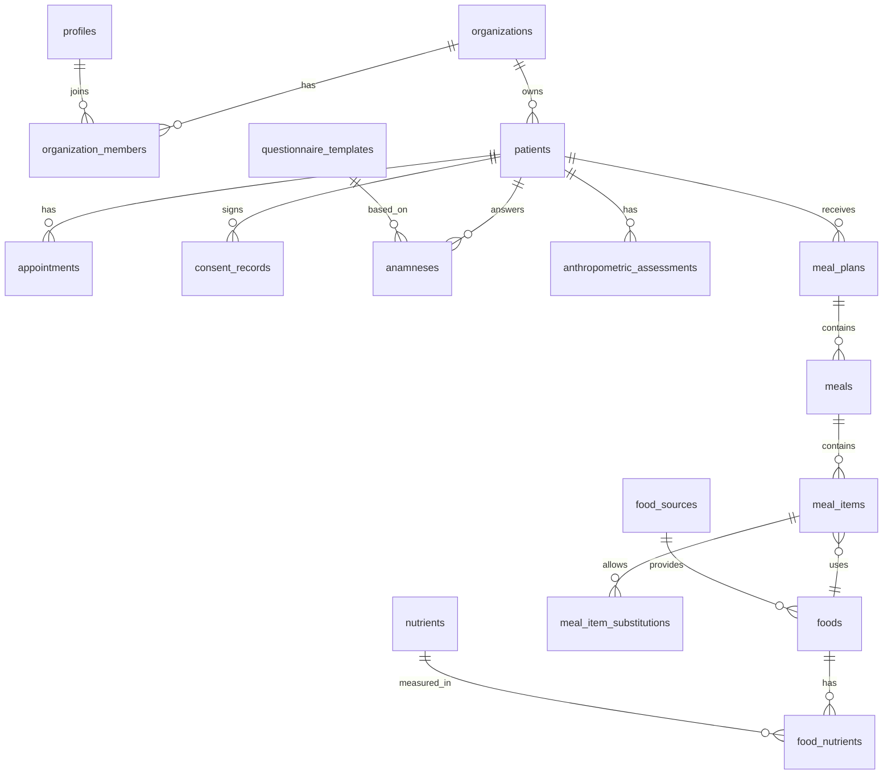

# 04 — Modelo de dados inicial (MVP)

> **Backend: Directus** ([ADR 0008](adr/0008-backend-directus.md)). Onde este documento cita Supabase, RLS, `auth.uid()`, Storage ou Edge Functions, leia pela tabela de equivalência do ADR 0008.

Escopo: núcleo comum + Módulo Clínico. Nomes de tabelas e colunas em inglês. Todas as tabelas têm `id uuid`, `created_at`, `updated_at`; as de negócio têm `organization_id`.

## Diagrama

## Entidades

### Contas e acesso
| Tabela | Campos principais |
|---|---|
| `organizations` | `name`, `type` (`solo`, `clinic`, `company`), `cnpj_cpf`, `logo_path`, `brand_color`, `plan` |
| `profiles` | `user_id` (auth.users), `full_name`, `crn` (nº do CRN), `crn_region`, `phone` |
| `organization_members` | `organization_id`, `profile_id`, `role` (`owner`, `nutritionist`, `assistant`) |
| `audit_logs` | `actor_id`, `action`, `entity`, `entity_id`, `ip`, `occurred_at` |

### Pacientes e atendimento
| Tabela | Campos principais |
|---|---|
| `patients` | `full_name`, `birth_date`, `sex`, `email`, `phone`, `cpf` (opcional), `auth_user_id` (quando usa o app), `status`, `responsible_nutritionist_id` |
| `consent_records` | `patient_id`, `terms_version`, `accepted_at`, `ip`, `channel` |
| `appointments` | `patient_id`, `nutritionist_id`, `starts_at`, `ends_at`, `type` (`first`, `return`), `mode` (`in_person`, `online`), `status`, `meeting_url` |
| `clinical_notes` | `patient_id`, `appointment_id`, `content`, `author_id` (evolução do prontuário) |

### Anamnese
| Tabela | Campos principais |
|---|---|
| `questionnaire_templates` | `name`, `schema jsonb` (perguntas, tipos, condicionais), `is_default` |
| `anamneses` | `patient_id`, `template_id`, `answers jsonb`, `status` (`sent`, `answered`, `reviewed`), `public_token`, `token_expires_at` |

### Antropometria
| Tabela | Campos principais |
|---|---|
| `anthropometric_assessments` | `patient_id`, `assessed_at`, `weight_kg`, `height_cm`, `circumferences jsonb`, `skinfolds jsonb`, `protocol`, `body_fat_pct`, `lean_mass_kg`, `bmi`, `notes` |

Valores calculados (IMC, % gordura) são calculados pelo `nutrition-core` e gravados junto com o `protocol` usado, para manter o histórico estável mesmo se a fórmula evoluir.

### Alimentos
| Tabela | Campos principais |
|---|---|
| `food_sources` | `code` (`TACO`, `TBCA`, `CUSTOM`), `version`, `license_notes` |
| `foods` | `source_id`, `organization_id` (nulo para bases públicas), `name`, `group`, `household_measures jsonb` |
| `nutrients` | `code` (`energy_kcal`, `protein_g`, `carbohydrate_g`, `lipid_g`, `fiber_g`, `sodium_mg`...), `unit` |
| `food_nutrients` | `food_id`, `nutrient_id`, `amount_per_100g` |

### Plano alimentar
| Tabela | Campos principais |
|---|---|
| `energy_calculations` | `patient_id`, `formula`, `activity_factor`, `inputs jsonb`, `ree_kcal`, `tee_kcal`, `target_kcal`, `macro_targets jsonb` |
| `meal_plans` | `patient_id`, `title`, `energy_calculation_id`, `status` (`draft`, `published`, `archived`), `published_at`, `is_template` |
| `meals` | `meal_plan_id`, `name` (café da manhã, almoço...), `time`, `position` |
| `meal_items` | `meal_id`, `food_id`, `quantity_g`, `household_measure`, `notes` |
| `meal_item_substitutions` | `meal_item_id`, `food_id`, `quantity_g` |

O paciente só enxerga `meal_plans` com `status = 'published'`.

## Regras de RLS (resumo)

- Membro da organização lê e escreve dados da própria organização, conforme papel.
- `assistant` acessa `patients` (dados cadastrais) e `appointments`, mas **não** `clinical_notes`, `anamneses`, `anthropometric_assessments` e `meal_plans`.
- Paciente (`auth.uid() = patients.auth_user_id`) lê apenas os próprios planos publicados, avaliações e agenda; escreve apenas respostas de anamnese e diário alimentar.
- Bases públicas de alimentos (`organization_id is null`) são somente leitura para todos os usuários autenticados.
- Anamnese respondida por link público passa por Edge Function que valida `public_token` (não há acesso anônimo direto à tabela).

## Fases seguintes (esboço)

- **Gestão:** `payments`, `service_packages`, `leads`, `message_logs`.
- **App do paciente:** `food_diary_entries`, `hydration_logs`, `chat_messages`.
- **Materno-infantil:** `growth_measurements`, `who_growth_references` (tabelas LMS), `pregnancy_records`.
- **UAN:** `production_units`, `recipes` (ficha técnica), `recipe_ingredients`, `menus`, `menu_days`, `purchase_orders`, `stock_movements`, `checklist_templates`, `checklist_runs`, `non_conformities`, `quality_documents`.
- **IA:** `ai_suggestions` (entrada, saída, modelo, aceite pelo profissional), `knowledge_chunks` com `embedding vector`.

## Plano gratuito e área do paciente (Fase 1B)

- **Tenant:** `organizations` (o nutricionista autônomo é uma organização `solo`).
- `plans` e `subscriptions`: toda organização nasce no plano `free`, que permite **20 pacientes ativos**. Um gatilho em `patients` aplica o limite no banco.
- O paciente acessa com login próprio (`patients.auth_user_id`). Uma pessoa atendida por dois nutricionistas tem um registro em cada organização.
- `patient_app_invites`: convite com token de uso único.
- `recipes` ganha foto, descrição, tempo, dificuldade e tags. `patient_recipes` registra as receitas enviadas ao paciente.
- `patient_recommendations`: recomendações individuais com rascunho, publicação e marcação de leitura.
- `patients.share_settings` define o que o paciente vê (calorias, macros, histórico de peso).

SQL completo e políticas RLS em [plano/fase-1b-freemium-area-paciente.md](plano/fase-1b-freemium-area-paciente.md).
