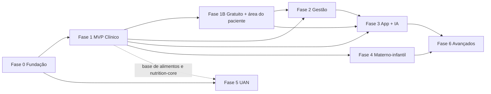

# Plano de implementação — Visão geral

> **Backend: Directus** ([ADR 0008](../adr/0008-backend-directus.md)). Onde os documentos de fase citam Supabase, RLS, `auth.uid()`, Storage ou Edge Functions, leia pela tabela de equivalência do ADR 0008.

Este é o plano detalhado da Rafanutri. O resumo executivo está em [../06-plano-implementacao.md](../06-plano-implementacao.md); aqui ficam o cronograma, as regras de trabalho e o link para cada fase.

## Documentos por fase

| Fase | Documento | IDs | Duração estimada |
|---|---|---|---|
| 0 | [Fundação](fase-0-fundacao.md) | RN-001 a RN-019 | 3 semanas |
| 1 | [MVP Clínico](fase-1-mvp-clinico.md) | RN-020 a RN-049 | 8 semanas |
| 1B | [Plano gratuito e área do paciente](fase-1b-freemium-area-paciente.md) | RN-200 a RN-219 | 3 semanas |
| 2 | [Gestão do consultório](fase-2-gestao.md) | RN-050 a RN-069 | 4 semanas |
| 3 | [App do paciente + IA](fase-3-app-paciente-ia.md) | RN-070 a RN-099 | 6 semanas |
| 4 | [Materno-infantil](fase-4-materno-infantil.md) | RN-100 a RN-119 | 4 semanas |
| 5 | [UAN e Qualidade (Enterprise)](fase-5-uan-qualidade.md) | RN-120 a RN-169 | 10 semanas |
| 6 | [Saúde pública e avançados](fase-6-saude-publica-avancados.md) | RN-170 a RN-199 | contínuo |

Premissa de capacidade: **1 a 2 desenvolvedores full-stack** e a nutricionista parceira (Rafaela) como responsável técnica e validadora de domínio. Com 1 desenvolvedor, multiplicar as durações por cerca de 1,6.

## Escopo do MVP

O MVP roda inteiro na vpsrafa e deixa a LGPD para depois ([ADR 0004](../adr/0004-infraestrutura-hospedagem.md)).

| Situação | Itens |
|---|---|
| Adiados | RN-016 (termos e DPA), RN-021 (consentimento do paciente), RN-059 (opt-out), RN-081 (pseudonimização para a IA) |
| Reduzidos | RN-063 (sem aprovação de templates da Meta), RN-067 e RN-089 (só documentação técnica) |
| Trocados | WhatsApp pela Evolution API; IA pelo OpenRouter `:free`; Supabase self-hosted |
| Mantidos mesmo no MVP | RLS (RN-008), backup externo (RN-003), segurança básica (RN-049) |
| Antecipados | Plano gratuito com 20 pacientes ativos e área do paciente com plano, receitas e recomendações (Fase 1B) |

**Convenção de rotas:** a área do profissional usa `/[orgSlug]/...` com nomes em português (Fases 0, 1 e 1B), e a do paciente usa `/p/...`. Onde os documentos das Fases 2 a 6 citam `/app/...`, leia como `/[orgSlug]/...`.

## Cronograma macro (2 desenvolvedores)

Considerando início na semana 1 (a definir):

```
Semana      1  2  3  4  5  6  7  8  9 10 11 12 13 14 15 16 17 18 19 20 21 22 23 24 25 26 27 28 29 30 31 32 33 34 35 36 37 38
Fase 0     ███████
Fase 1              ████████████████████████
Fase 1B                                     █████████
Fase 2                                               ████████████
Fase 3                                                           ██████████████████
Fase 4                                                                             ████████████
Fase 5                                                                             ██████████████████████████████
Fase 6                                                                                                          ███ →
Marcos                                              ▲Beta (gratuito)  ▲Lançamento pago  ▲App   ▲Piloto UAN
```

O gráfico mostra as fases 4 e 5 em paralelo, com 1 desenvolvedor em cada. Nesse arranjo a Fase 5 se estende (ver "Conferência de capacidade"). A alternativa é fazê-las em sequência, com os 2 desenvolvedores juntos em cada uma. A ordem entre elas depende de haver um cliente piloto Enterprise fechado: se houver, a Fase 5 vem antes.

## Marcos

| Marco | Quando | Critério | Decisão de negócio |
|---|---|---|---|
| M0 — Base pronta | Fim da Fase 0 | Login, organizações, RLS testada, TACO importada | Seguir para o MVP |
| M1 — Beta com plano gratuito | Fim da Fase 1B | Consulta completa com PDF em menos de 10 minutos; paciente vê plano, receitas e recomendações; limite de 20 pacientes ativo | Abrir o plano gratuito para 5 a 10 nutricionistas e depois para todos |
| M2 — Lançamento pago | Fim da Fase 2 | Cobrança automática e lembretes funcionando | Abrir vendas; validar preços |
| M3 — App do paciente | Fim da Fase 3 | PWA em uso pelos pacientes dos beta | Medir retenção; decidir app nativo |
| M4 — Piloto Enterprise | Fim da Fase 5 | Uma unidade operando sem planilha | Precificar e vender Enterprise |

## Dependências entre fases



## Formato dos itens

Cada item do backlog, nos documentos de fase, segue:

```
### RN-0XX — Título
- Tipo: feature | infra | doc | pesquisa
- Pontos: 1, 2, 3, 5 ou 8
- Depende de: IDs
- Descrição
- Tarefas técnicas (checklist)
- Arquivos/áreas
- Critérios de aceite (Dado / Quando / Então)
- Testes
```

**Pontos:** 1 = até meio dia; 2 = cerca de 1 dia; 3 = cerca de 2 dias; 5 = 3 a 4 dias; 8 = 1 semana ou mais (avaliar quebrar). Referência de velocidade inicial: 8 a 10 pontos por desenvolvedor por semana (16 a 20 por ciclo de 2 semanas), recalibrada após o primeiro ciclo.

### Conferência de capacidade

| Fase | Pontos | Semanas × devs | Pontos por dev/semana |
|---|---|---|---|
| 0 | 58 | 3 × 2 | 9,7 |
| 1 | 119 | 8 × 2 | 7,4 |
| 1B | 50 | 3 × 2 | 8,3 |
| 2 | 69 | 4 × 2 | 8,6 |
| 3 | 63 | 6 × 2 | 5,3 |
| 4 | 65 | 4 × 2 | 8,1 |
| 5 | 209 | 10 × 2 | 10,5 (no limite) |
| 6 | 134 | contínuo | — |

A Fase 5 só cabe em 10 semanas com os **2 desenvolvedores dedicados**. Se rodar em paralelo com a Fase 4 (1 desenvolvedor em cada), leva cerca de 20 semanas, ou é preciso tirar do piloto APPCC e rotulagem (RN-160 a RN-164, 21 pontos), que podem ir para depois sem prejudicar o piloto.

## Definição de pronto para começar (Definition of Ready)

Um item só entra no ciclo quando:
- tem critérios de aceite claros;
- as dependências estão concluídas ou em andamento no mesmo ciclo;
- regras de domínio (fórmulas, normas) foram validadas pela nutricionista, quando aplicável;
- o desenho de tela existe, quando o item tem interface.

## Definição de pronto para entregar (Definition of Done)

- Código revisado por outra pessoa (pull request aprovado).
- Lint, typecheck, testes e build passando no CI.
- Migração com política RLS e teste de isolamento, quando cria tabela.
- Testes unitários para toda regra de cálculo; e2e para fluxos principais.
- Funciona em telas de celular (360 px) e de computador.
- Acessibilidade básica: navegação por teclado, contraste e rótulos nos formulários.
- Documentação atualizada (`docs/`, README, `.env.example`).
- Demonstrado no ambiente de staging.

## Fluxo de trabalho no repositório

| Tema | Convenção |
|---|---|
| Branch principal | `main`, sempre implantável; protegida |
| Branches de trabalho | `feat/RN-031-editor-plano`, `fix/RN-032-arredondamento`, `docs/...`, `chore/...` |
| Commits | Conventional Commits em português: `feat(clinico): editor de plano alimentar (RN-031)` |
| Pull requests | Um item por PR quando possível; descrição com o ID, o que mudou, como testar e prints |
| Migrações | `supabase/migrations/<timestamp>_<nome>.sql`; nunca editar migração já aplicada em staging |
| Versões | Tags semânticas a partir do beta (`v0.1.0` = M1) |
| Deploy | Merge em `main` → staging automático; produção por tag com aprovação manual |

## Ambientes e dados

| Ambiente | Uso | Dados |
|---|---|---|
| Local | Desenvolvimento | Seed sintético |
| Staging | Validação e demonstração | Seed sintético; nunca dados reais |
| Produção | Clientes | Dados reais; acesso restrito e auditado |

## Cerimônias (ciclos de 2 semanas)

| Momento | Duração | Objetivo |
|---|---|---|
| Planejamento | 1 h | Escolher itens do ciclo pelo backlog |
| Revisão de domínio | 30 min/semana | Validar fórmulas, telas e textos com a nutricionista |
| Demonstração | 30 min | Mostrar o que foi entregue no staging |
| Retrospectiva | 30 min | Ajustar o processo e a velocidade |

## Gestão de riscos transversais

| Risco | Sinal de alerta | Resposta |
|---|---|---|
| Atraso acumulado | Velocidade abaixo de 70% do planejado por 2 ciclos | Cortar itens P1/P2 da fase; não cortar testes nem segurança |
| Validação de domínio travando | Itens parados aguardando a nutricionista | Agenda fixa semanal de revisão; lista de dúvidas assíncrona |
| Mudança de prioridade comercial | Cliente Enterprise pronto para fechar | Antecipar Fase 5 em paralelo, mantendo a Fase 2 |
| Dívida técnica | Bugs reabertos, testes frágeis | Reservar 15% de cada ciclo para melhorias |
